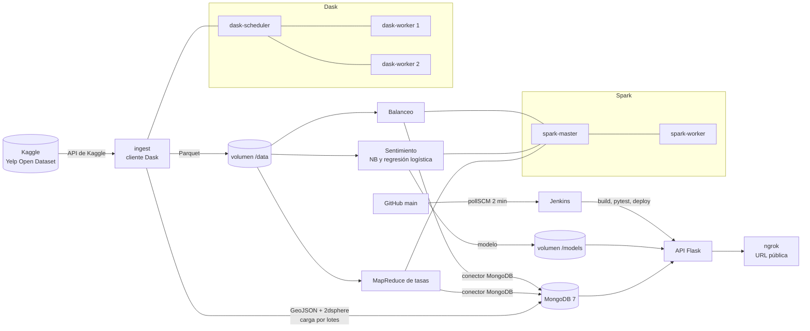

# LifeMap: reputación, ubicación y supervivencia de negocios

Proyecto final de Big Data (IUE, 2026-2), **Entrega 1**: plataforma batch con el texto de las reseñas clasificado, la vida de cada negocio construida y las tasas de cierre calculadas con MapReduce, desplegada en una URL pública con Jenkins.

**Equipo:** Santiago Arcila Gutiérrez, Alejandro Restrepo Uribe, Natalia Florez Pérez
**Docente:** Andrés Felipe Hernández Marulanda
**Área y familia:** Tampa (Florida), radio 45 km · Restaurantes

## URL pública

**https://strategy-chowtime-unified.ngrok-free.dev**

| Ruta | Qué muestra |
|---|---|
| `/` | Mapa: clic en un punto para ver negocios a 1 km y el resumen de la zona a 2 km |
| `/health` | Estado de MongoDB, Spark, Dask, la API y el modelo, con el **hash del commit desplegado** |
| `/reports` | Reportes de la ingesta, el MapReduce, el modelo y el balanceo (JSON) |

## Arquitectura



Todo corre en un solo `docker-compose.yml` (proyecto `lifemap`):

| Servicio | Función | Puerto local |
|---|---|---|
| `mongo` | MongoDB 7: `businesses` (GeoJSON, 2dsphere), `reviews`, tasas y métricas | 127.0.0.1:27020 |
| `spark-master`, `spark-worker` | Spark 3.5.3 con MongoDB Spark Connector 10.4 | 8082 (UI) |
| `dask-scheduler`, `dask-worker` ×2 | Ingesta y limpieza distribuida | 8788 (UI) |
| `ingest` | Descarga de Kaggle, limpieza con Dask, vida de los negocios, carga a MongoDB | — |
| `spark-mapreduce`, `spark-sentimiento`, `spark-balanceo` | Trabajos de Spark | — |
| `api` | API Flask (gunicorn) | 5050 |
| `tunnel` | ngrok: publica la API en la URL fija del equipo | 127.0.0.1:4040 |
| `jenkins` | CI/CD: construye, prueba y despliega al integrar a main | 8083 |

Los trabajos de ingesta y de Spark se ejecutan una vez y terminan. Si sus resultados ya existen, no se repiten (salvo `FORCE_INGEST=true` / `FORCE_SPARK=true`).

## Levantar el sistema desde cero

Requisitos del servidor: Docker Desktop con **al menos 8 GB de RAM** asignados y **25 GB libres** en disco (Yelp descomprimido pesa unos 9 GB), y Git.

```powershell
# 1. Clonar
git clone https://github.com/USUARIO/lifemap.git
cd lifemap

# 2. Variables y secretos (este archivo NO se sube a GitHub)
copy .env.example .env      # en Linux/Mac: cp .env.example .env
#    Editar .env: JENKINS_ADMIN_PASSWORD, GIT_REPO_URL, KAGGLE_USERNAME, KAGGLE_KEY,
#    NGROK_AUTHTOKEN y NGROK_DOMAIN

# 3. Levantar todo. La primera vez descarga Yelp y corre la ingesta y Spark (30 a 60 min)
docker compose up -d --build

# 4. Seguir el avance
docker compose logs -f ingest spark-mapreduce spark-sentimiento

# 5. Medición de balanceo (unos minutos)
docker compose --profile benchmark run --rm spark-balanceo

# 6. Publicar la API en la URL pública
docker compose --profile tunnel up -d tunnel
```

Comprobar: http://localhost:5050/health en el servidor y `https://strategy-chowtime-unified.ngrok-free.dev/health` desde cualquier lugar.

- **Kaggle:** kaggle.com → Settings → API → *Create New Token*. El archivo `kaggle.json` trae `username` y `key`.
- **ngrok:** cuenta gratis en dashboard.ngrok.com. *Your Authtoken* va en `NGROK_AUTHTOKEN` y el dominio gratis de *Domains* en `NGROK_DOMAIN`. El dominio es fijo: no cambia aunque se reinicie el servidor.
- **Área y categoría:** están en `docker-compose.yml` (`AREA_LAT`, `AREA_LON`, `AREA_RADIUS_KM`, `CATEGORY_FAMILY`) para que Jenkins use los mismos valores. Si se cambian, hay que correr de nuevo con `FORCE_INGEST=true` y `FORCE_SPARK=true`.

## Despliegue continuo (Jenkins)

Jenkins queda configurado como código (`jenkins/casc.yaml`): al arrancar ya tiene el usuario administrador, la credencial `kaggle-api` (tomada del `.env`, nunca del repositorio) y el job `lifemap`.

- **Disparo:** `pollSCM` cada 2 minutos sobre `main`. Jenkins corre en el servidor del equipo sin URL pública, así que GitHub no puede llamarlo por webhook; el enunciado acepta pollSCM documentado.
- **Etapas:** checkout → build de imágenes → **pytest unitarias** (incluye la fórmula de la tasa de cierre) → servicios → ingesta (solo si falta) → Spark (MapReduce y sentimiento, solo si faltan) → staging → **pruebas de humo contra la API** → despliegue → verificación de que `/health` muestra el commit de `main`.
- **Si una prueba falla, no se despliega:** la API pública sigue con la versión anterior.
- Jenkins usa el socket de Docker del servidor (`/var/run/docker.sock`) para construir imágenes y manejar los mismos contenedores.

Panel de Jenkins: http://localhost:8083 (usuario `admin` y la clave del `.env`).

## Endpoints

| Endpoint | Parámetros | Consulta |
|---|---|---|
| `GET /health` | — | Estado de cada servicio + commit |
| `GET /businesses/near` | `lat`, `lon`, `radio` (m, máx. 50.000), `categoria`?, `limit`? | `$near` |
| `GET\|POST /businesses/within` | Polígono GeoJSON en el cuerpo o `?poligono=`; `categoria`? | `$geoWithin` |
| `GET /zones/summary` | `lat`, `lon`, `radio`, `categoria`?, `min_dias`? | `$geoNear` + `$group`: sentimiento medio y tasa de cierre |
| `GET /stats/closure` | `por=categoria\|celda`, `min_dias` (por defecto 36.500), `orden`, `limit` | Tasas del MapReduce |
| `GET\|POST /predict` | `texto` | Sentimiento con el modelo entrenado en Spark |

Todos validan sus parámetros y responden **400** con un mensaje si algo no es válido.

```bash
curl "https://strategy-chowtime-unified.ngrok-free.dev/businesses/near?lat=27.9506&lon=-82.4572&radio=1000&categoria=Mexican"
curl -X POST "https://strategy-chowtime-unified.ngrok-free.dev/businesses/within" -H "Content-Type: application/json" \
     -d '{"type":"Polygon","coordinates":[[[-82.47,27.94],[-82.44,27.94],[-82.44,27.96],[-82.47,27.96],[-82.47,27.94]]]}'
curl "https://strategy-chowtime-unified.ngrok-free.dev/zones/summary?lat=27.9506&lon=-82.4572&radio=2000"
curl "https://strategy-chowtime-unified.ngrok-free.dev/stats/closure?por=celda&min_dias=36500"
curl -X POST "https://strategy-chowtime-unified.ngrok-free.dev/predict" -H "Content-Type: application/json" -d '{"texto":"Great tacos, friendly staff"}'
```

## Datos y definiciones

- **Dataset:** Yelp Open Dataset (Kaggle `yelp-dataset/yelp-dataset`), archivos `business.json` y `review.json`, descargados por el pipeline con la API de Kaggle.
- **Limpieza** (los conteos antes y después de cada regla están en `/reports/ingesta`):
  - Negocios: se descartan los que tienen coordenadas nulas, fuera de rango o fuera del área; los que no son de la familia; y los duplicados.
  - Reseñas: se descartan las de negocios fuera del área, sin texto, con estrellas o fechas inválidas, y las duplicadas por `review_id`.
- **Sentimiento:** 1–2 estrellas es negativo, 3 neutral y 4–5 positivo.
- **Vida de un negocio:** de su primera a su última reseña, en días-negocio.
  - **Evento:** `is_open = 0` (cierre observado).
  - **Censura:** `is_open = 1` (seguía abierto en la fecha de corte, la última reseña del área).
  - Todos tienen **entrada tardía**, porque el negocio ya existía antes de su primera reseña.
  - Es una aproximación: Yelp no trae fechas de apertura ni de cierre.
- **Tasa de cierre anualizada:** `cierres ÷ (días-negocio ÷ 365) × 100`, la misma fórmula de la AFR del ejercicio de discos.
  - **Mínimo para comparar grupos:** 36.500 días-negocio (100 años-negocio). Con esa exposición, un cierre más o menos mueve la tasa a lo sumo 1 punto.
- **Celdas:** geohash de 5 caracteres (unos 4,9 × 4,9 km).

## Modelo de sentimiento

- **Pipeline de SentimentStream:** limpieza → `RegexTokenizer` → `StopWordsRemover` (inglés) → `HashingTF` (65.536) → `IDF`.
- **Clasificadores:** Naive Bayes multinomial y regresión logística multinomial, ambos con pesos por clase para compensar el desbalance.
- **Partición por negocio:** `abs(hash(business_id)) % 10 < 8` es entrenamiento. Ningún negocio queda en los dos lados.
- **Modelos guardados:** en `/models/sentiment_nb`, `/models/sentiment_lr` y `/models/sentiment_v1` (el mejor por F1 macro, para la Entrega 2).
- **`/predict`:** no carga Spark. Replica en Python el mismo `HashingTF` (MurmurHash3, semilla 42) con los pesos exportados, y el trabajo de Spark verifica que ambas predicciones coinciden.

## Forma de trabajo en GitHub

Cada integrante trabaja en su rama y abre un pull request hacia `main`; al hacer merge, Jenkins despliega. Para mostrar que una prueba fallida bloquea el despliegue, se abrió un PR que rompe la prueba de la fórmula y quedó un build en rojo en el historial de Jenkins.

## Estructura

```
├── docker-compose.yml   Jenkinsfile   .env.example
├── ingest/              Dask: descarga, limpieza, vida de los negocios, carga a MongoDB
├── spark/jobs/          mapreduce.py · sentimiento.py · balanceo.py · comun.py · textomodelo.py
├── api/                 Flask: app.py · queries.py · sentiment.py · tests/unit · tests/smoke · static/
└── jenkins/             imagen con Docker CLI + configuración como código
```

## Fuentes

- Yelp Open Dataset, vía Kaggle (`yelp-dataset/yelp-dataset`). Se usa según los términos de uso de Yelp.
- Se reutilizan piezas de trabajos anteriores del equipo: SentimentStream, KafkaMed, el sistema geoespacial y el ejercicio de discos.
- Parte del código se desarrolló con apoyo de un asistente de IA (Claude, de Anthropic) y fue revisado, probado y adaptado por el equipo.
